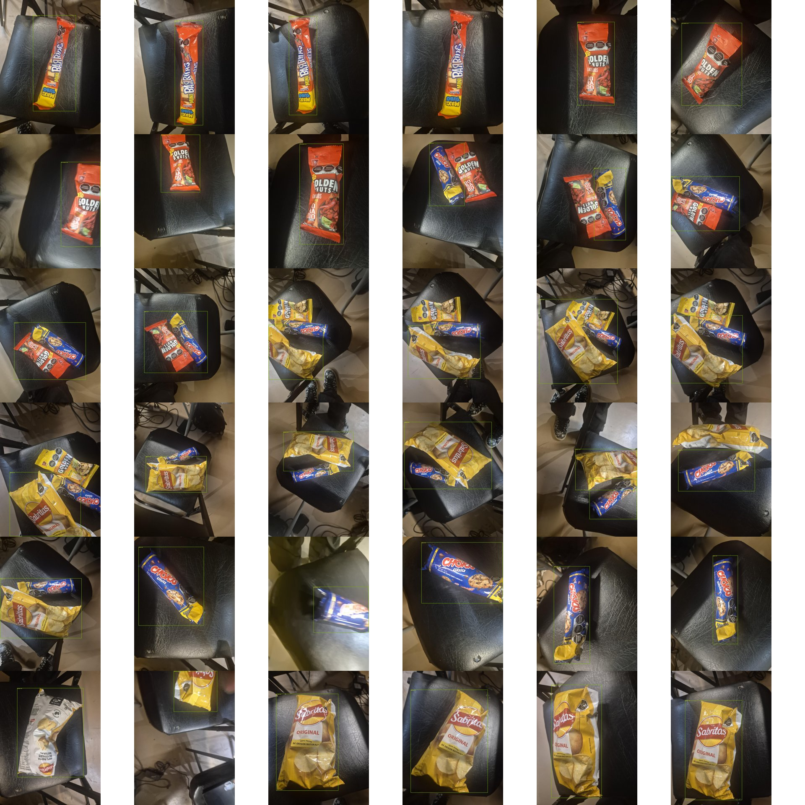

# Caja Clara — Modelos de IA: entrenamiento, evaluación y despliegue

<p class="fuente">Hackathon NVIDIA Oaxaca 2026 · Economía Digital · Documento técnico 02 · 2026-11-20.
Cada cifra lleva su archivo de origen en el repositorio. Lo que no está registrado aparece como
<span class="falta">[FALTA: …]</span>.</p>

## 0. Resumen

| Componente | Tarea | Modelo base | Adaptación | Dónde se entrenó | Herramienta NVIDIA | Métrica principal | Latencia |
|---|---|---|---|---|---|---|---|
| **Detector de productos** (app: v3) | Detectar y contar 7 productos + `otro_producto` en la foto del mostrador | DINO ResNet-50 preentrenado en COCO (NGC) | Ajuste fino completo, 12 épocas | Tesla T4, servidor DLI | TAO Toolkit 5.5 · TensorRT 11.5 | Fotos propias p03: conteo exacto **67 %**, falsos positivos 11 %. Test público: mAP **0.857**, mAP50 1.000 | **89.2 ms** mediana (RTX 2060) |
| **Asistente** (texto/voz → acción) | Convertir lo dicho o escrito en una acción JSON | Qwen2.5-1.5B-Instruct | LoRA r=16 (PEFT) | Tesla T4, servidor DLI | Contenedor PyTorch de TAO 5.5 (entrenamiento) | Coincidencia exacta 1.4 % → **86.5 %** (74 casos); reservados 0/14 → **13/14** | **1.07 s** (RTX 2060) |
| **Gundani** (caja y cobros simulados) | Consultas de caja y cobro QR simulado | Qwen2.5-3B-Instruct | QLoRA 4 bits | Tesla T4, contenedor DLI | GPU T4 del DLI | Intención exacta 57.1 % → **85.7 %**; monto correcto 42.9 % → **100 %** (14 casos) | **8.6 s** en el VPS (CPU, GGUF); 10.3 s en T4 |

<p class="fuente">Fuentes: cada cifra se detalla en su sección (A.3–A.7, B.4–B.6, C.2). Además usamos un componente que no
entrenamos: Nemotron 3.5 Super VL, por la API de NVIDIA, para transcribir la foto de la libreta (sección B.6).</p>

## A. Modelo de visión: detector de productos

### A.1 Tarea y clases

El detector localiza y cuenta, en una sola foto del mostrador, **7 productos de tiendita**: `chokis`,
`coca_cola`, `doritos`, `gansito`, `panditas`, `sabritas` y `skittles`. Desde v2 también tiene la clase
**`otro_producto`**, que sirve para marcar los empaques que no son del catálogo y no entra en las métricas.
Contar por foto sustituye el paso que más tiempo y errores genera: anotar a mano, uno por uno, lo que se lleva
el cliente. La persona **revisa y corrige** la cuenta antes de guardarla, así que el modelo propone y no
decide (`README.md`, recorrido principal).

### A.2 Datos

- **Fuentes públicas (CC BY 4.0, con atribución):** *ProductosOXXO_V02* v3, autor Ipsum
  (universe.roboflow.com/ipsum/productosoxxo_v02), y *Dataset Mercado* v1, autor FundamentosIA
  (universe.roboflow.com/fundamentosia/dataset-mercado). Fuente: `docs/DECLARACION_IA_Y_LICENCIAS.md`.
- **Fotos propias por sesión:** p01, p02 y p04 se usaron para **entrenar**. **p03 (36 fotos) quedó reservada
  solo para la prueba** y nunca entró al entrenamiento (`evaluacion/v3_p03/resultados.json`, `fotos: 36`).
  Las fotos con caras se excluyeron y el conjunto no contiene datos personales
  (`evaluacion/v3_p03/resultados.md`; declaración, sección 3).
- **Sin fugas entre conjuntos** (`training/vision/preparar_datos.py`):
  - las variantes aumentadas de una misma imagen (`*.rf.*`) se agrupan antes de dividir;
  - la división es 80/10/10 por grupo con **semilla 1234**;
  - los duplicados exactos se descartan por **SHA-1**;
  - las fotos propias se asignan por **sesión** completa.

**Distribución** (`training/vision/logs/distribucion_datos_v2.json`; train v1 de la regeneración del 2026-11-20;
train v2 en `training/vision/logs/distribucion_train_v2_reconstruida.json`):

| Conjunto | Imágenes | Propias | Objetos | chokis | coca_cola | doritos | gansito | panditas | sabritas | skittles | otro_producto |
|---|---|---|---|---|---|---|---|---|---|---|---|
| train v1 (solo públicas) | 819 | 0 | 819 | 51 | 376 | 69 | 154 | 41 | 60 | 68 | 0 |
| train v2 (+ p01, p02) ¹ | 913 | 94 | 917 | 61 | 376 | 69 | 154 | 41 | 80 | 68 | 68 |
| **train v3** (+ p04) | 930 | 111 | 956 | 78 | 376 | 69 | 154 | 41 | 91 | 68 | 79 |
| val | 97 | 0 | 98 | 5 | 56 | 3 | 11 | 12 | 11 | 0 | 0 |
| test (público) | 106 | 0 | 106 | 0 | 47 | 18 | 15 | 11 | 6 | 9 | 0 |

Al regenerar el split desde Roboflow (2026-11-20) el test salió **idéntico** y el train público dio 819. El JSON
se llama "v2" por un nombre fijo en `preparar_datos.py`, pero su train es el de **v3**. ¹ Train v2 = train v3 − p04
(`datos_propios/p04_annotations.coco.json`). Lo confirman los logs: con batch 2 y el último batch incompleto
descartado, 819/913/930 imágenes dan 409/456/465 pasos por época, como en `entrenamiento_dino_v{1,2,3}.log`.

### A.3 Modelo y entrenamiento

- **Base:** DINO (*DETR with Improved deNoising anchOr boxes*) con backbone ResNet-50, preentrenado en COCO.
  Viene de NGC: `nvidia/tao/pretrained_dino_coco:dino_resnet_50_trainable_v1.0`, archivo
  `dino_resnet50_ep12.pth`, sha256 `7a391fb84a18714b60258becdb512594ec54faff5dccbf17ca53c5d902137512`
  (cuaderno `02_caja_clara_detector_dino.ipynb`, celda 17).
- **Entrenamiento:** TAO Toolkit 5.5 en una **Tesla T4** de los servidores DLI (`logs/bitacora_v2.txt`, `bitacora_v3.txt`).

| Hiperparámetro | Valor | | Hiperparámetro | Valor |
|---|---|---|---|---|
| Épocas | 12 | | `lr` / `lr_backbone` | 2e-4 / 2e-5 |
| Batch | 2 | | `lr_steps` | [9] (lr ×0.1 desde la época 10) |
| Precisión | fp16 | | `num_classes` | 9 en v2 y v3 (8 + fondo); 8 en v1 |
| Queries / capas enc-dec | 300 / 6-6 | | Escalas de entrenamiento | 480–640, máximo 800 |

<p class="fuente">Fuente: <code>training/vision/specs/train.yaml</code>, <code>train_v2.yaml</code>, <code>train_v3.yaml</code>. Duración en la T4: v1 ≈ 50 min
(<code>logs/status.json</code>), v2 65 min y v3 44 min (primer `FIN` de la bitácora) (<code>bitacora_v2.txt</code>, <code>bitacora_v3.txt</code>).</p>

![Figura 1. Curvas de entrenamiento extraídas de `training/vision/logs/entrenamiento_dino_v{1,2,3}.log`. Las tres versiones convergen igual. La caída en la época 10 corresponde a `lr_steps: [9]`. El mAP@[.5:.95] de validación termina en 0.911 (v1), 0.904 (v2) y 0.903 (v3); el mAP50 de validación queda en 0.997 en las tres.](img/curvas_dino.png)

### A.4 Iteraciones v1 → v2 → v3

| Versión | Qué cambió | Por qué |
|---|---|---|
| v1 | Solo datos públicos, 7 clases | Línea base. En fotos propias detectaba algo en el **100 %** de las fotos que solo tenían distractores |
| v2 | + p01 y p02; **clase `otro_producto`**; **7 correcciones** de etiquetas (`datos_propios/correcciones_manuales.txt`) | Decir "no es del catálogo" en vez de forzar una clase; etiquetas pre-generadas con v1 y corregidas a mano |
| v3 (app) | + **p04** (17 imágenes, 39 objetos, `p04_annotations.coco.json`) | Más mezclas reales de productos |

### A.5 Evaluación

**Fotos propias reservadas (p03, 36 fotos, umbral 0.5).** Es la prueba más parecida al uso real: fotos de
celular en el mostrador, con distractores (`training/vision/evaluacion/v{1,2,3}_p03/resultados.json`, generados con `training/detector/evaluar_piloto.py`).

| Métrica (p03, umbral 0.5) | v1 | v2 | **v3** |
|---|---|---|---|
| Conteo exacto (el conteo coincide con la etiqueta) | 31 % | 64 % | **67 %** |
| Detecta cada producto esperado | 41 % | 52 % | **59 %** |
| Falsos positivos (fotos solo con distractores) | 100 % | 0 % | 11 % |

**Test público (106 imágenes), con pycocotools.** Inferencia con los engines TensorRT en la RTX 2060 y umbral
0.01, sin contar `otro_producto` (`logs/eval_test_publico_v{1,2,3}.json`):

| Versión | mAP@[.5:.95] | mAP@.5 | coca_cola | doritos | gansito | panditas | sabritas | skittles |
|---|---|---|---|---|---|---|---|---|
| v1 | 0.893 | 1.000 | 0.731 | 0.978 | 0.847 | 0.944 | 0.956 | 0.902 |
| v2 | 0.887 | 1.000 | 0.695 | 0.958 | 0.877 | 0.931 | 0.963 | 0.899 |
| v3 | 0.857 | 1.000 | 0.708 | 0.918 | 0.840 | 0.905 | 0.917 | 0.851 |

- `chokis` no tiene objetos en este test, así que no entra al promedio (criterio COCO).
- Esta evaluación usó TensorRT, no `tao evaluate`. En TAO, v1 había dado mAP 0.915 (cuaderno, celda 26), por
  lo que la cifra puede variar un poco según el motor.
- El test público son fotos de catálogo con un producto cada una, parecidas a las de entrenamiento:
  **sobreestima** el desempeño. La bajada de v1 a v3 aquí, junto con la subida en p03, indica que v2 y v3
  cambiaron precisión en fotos de catálogo por robustez en fotos reales.
- **El umbral 0.5 no se eligió con el test.** Es el valor por defecto de `servir_detector.py` desde su primer
  commit (`21ef0e8`, 2026-11-19), que es anterior a todas las evaluaciones con fotos propias (`26471a3` y `ae43471`). No se
  movió al ver los resultados: en p03 un umbral de 0.7 habría dado 0 % de falsos positivos y aun así se dejó 0.5.
- **Modelo base, no comparable:** el DINO de COCO no tiene ninguna de nuestras 7 clases, así que su mAP en
  esta tarea es 0 por definición. Por eso comparamos v1, v2 y v3 entre sí con los mismos datos reservados.

### A.6 Análisis de errores (v3, p03, umbral 0.5, `evaluacion/v3_p03/resultados.md`)

<figure>

<figcaption>Figura 2. Mosaico de las 36 fotos p03 con las cajas de v3 (<code>training/vision/evaluacion/v3_p03/mosaico.jpg</code>).</figcaption>
</figure>

- **Chokis junto a sabritas:** en **9 de 11** fotos de "mezcla" (p03_015 a p03_022 y p03_025) solo se detectó
  sabritas. En una más (p03_024, sabritas de reverso) se detectó solo chokis. Solo 1 de 11 mezclas salió exacta.
- **Barritas Marinela leídas como doritos** (p03_002): es un distractor que nunca apareció en entrenamiento.
- **Foto muy movida** (p03_027, chokis sola): no detectó nada.

**Qué haríamos para corregirlo:** más fotos propias de **mezclas chokis + sabritas** (hoy el train tiene
78 chokis contra 376 coca_cola); etiquetar como `otro_producto` los empaques rojo con amarillo parecidos a
doritos; probar un umbral por clase elegido con **validación**, nunca con p03 ni con el test; y avisar en la
app cuando la foto esté movida.

**Ejemplo de inferencia real** con una foto de prueba no usada en entrenamiento, `p03_022.jpg` (chokis +
sabritas), por el gateway (`logs/pruebas_app_2026-11-20.json`, caso 1):

```
POST /detectar  ->  {"detecciones": [{"producto": "sabritas", "confianza": 0.856, "caja": [30.2, 319.3, 1470.4, 1426.3]}],
                     "conteo": {"sabritas": 1}, "ms": 221.8, "requiere_revision": true, "sha256_engine": "e58f31e3…"}
```

No detectó las chokis (el error descrito arriba). La app muestra la cuenta y la persona agrega las chokis a
mano antes de cobrar.

### A.7 Despliegue en la laptop

La cadena es: **checkpoint TAO** (`model_epoch_011.pth`) → `tao model dino export` → **ONNX** (opset 17,
entrada `1×3×640×640`, salidas `pred_logits` y `pred_boxes`) → `training/detector/construir_engine.py` →
**engine TensorRT 11.5** construido en la **RTX 2060** de la laptop (el engine depende de la GPU y de la versión
de TensorRT con que se construye).

- **Plugin:** el ONNX usa la capa `MultiscaleDeformableAttnPlugin_TRT` (dominio `nvidia`).
  `construir_engine.py` carga los plugins de TensorRT antes de leer el ONNX.
- **FP32:** en TensorRT 11.5 la red se construye con los tipos que trae el ONNX (`precision: "tipos_del_onnx"`
  en `training/detector/dino_rtx2060_fp32.engine.json`), y los pesos del ONNX exportado están en float32. Por
  eso el engine corre en FP32 aunque se entrenó en fp16. A cambio, los resultados no cambian respecto al ONNX.
  Pasar a FP16 está pendiente.

| Versión | Checkpoint (sha256) | ONNX (sha256) | Engine RTX 2060 (sha256) |
|---|---|---|---|
| v1 | `5043152a…a739cfe3` | `8e534815…f67bceac` | `a146d3bf…c4c981a2` |
| v2 | `01bab6c9…12938e5f` | `eb168115…06ec4c5a` | `c3be861c…a6aa6ed8` |
| **v3 (app)** | `6abf1b0a…c77c41a2` | `1ecd0cc1…62de4eb4` | **`e58f31e3…f81a31ed`** |

<p class="fuente">Fuentes: <code>training/vision/logs/hashes_v{1,2,3}.txt</code> (checkpoint y ONNX; los de v1 se calcularon el 2026-11-20 sobre las copias descargadas del DLI);
<code>logs/eval_test_publico_v{1,2,3}.json</code> (<code>sha256_engine</code> del engine cargado); <code>modelos/README.md</code>.
Nota: el sha256 completo del engine v3 es <code>e58f31e320305dfd1652907b0501d8fb6361af8864d53c92f5fd9842f81a31ed</code>, el mismo que muestra la app en
<i>Libro → Modelos de IA en uso</i>. <b>Latencia:</b> mediana de <b>89.2 ms</b> por foto en la RTX 2060, incluyendo
preproceso y postproceso (<code>evaluacion/v3_p03/resultados.json</code>, <code>ms_mediana</code>).</p>

**Código y pesos.**

- **Entrenamiento:** cuaderno `training/vision/02_caja_clara_detector_dino.ipynb` con los specs
  `training/vision/specs/train*.yaml`; los datos se preparan con `training/vision/preparar_datos.py`.
- **Engine e inferencia:** `training/detector/construir_engine.py` construye el engine y
  `servir_detector.py` (`API_DETECTOR.md`) lo sirve.
- **Pesos:** `.pth`, `.onnx` y `.engine` pesan más de 100 MB y no caben en GitHub. Se entregan en el paquete
  de entrenamiento (`modelos/README.md`). Cualquiera puede verificar el engine cargado con `GET /salud`, que
  devuelve su sha256.

## B. Modelo de lenguaje: asistente

### B.1 Tarea y esquema

El asistente convierte lo que la persona **dice** (reconocimiento de voz de Android) o **escribe** en **una
sola acción JSON**. Las acciones son: `agregar`, `quitar`, `forma_pago`, `consulta`, `registrar_libreta`,
`consulta_ley`, `confirmar`, `aclarar` y `fuera_de_alcance`. El modelo **solo propone**; el código del
servidor valida la acción y calcula precios y totales (`training/asistente/servir_asistente.py`).

```
{"accion": "agregar", "productos": [{"producto": "sabritas", "cantidad": 2}, {"producto": "coca_cola", "cantidad": 3}]}
{"accion": "aclarar", "pregunta": "..."}          {"accion": "confirmar", "pregunta": "¿Seguro que quieres borrar toda la venta? ..."}
{"accion": "fuera_de_alcance", "respuesta": "Solo puedo ayudarte con tus ventas, cobros, caja y pagos digitales."}
```

### B.2 Modelo base: Qwen2.5-1.5B-Instruct

**Por qué:** su **tamaño** (1.5 mil millones de parámetros, ~3 GB, `API_ASISTENTE.md`) cabe en fp16 en la
RTX 2060 de 6 GB y responde en ~1 s, así que corre en una **GPU de consumo**. Funciona en **español**: el dataset y
los 74 casos de evaluación están en español y B.5 mide esa capacidad. Su **licencia** es Apache 2.0
(`DECLARACION_IA_Y_LICENCIAS.md`).

### B.3 Dataset

Es **sintético**: se genera con plantillas a partir del catálogo usando
`training/asistente/generar_dataset.py --n 1400 --seed 1234`. Para evitar fugas, **val y test usan plantillas
distintas de las de train** (`data/resumen.json`, campo `nota`).

| Conjunto | Ejemplos | Uso |
|---|---|---|
| train | 1,165 (agregar 516, quitar 134, libreta 133, consulta 110, fuera de alcance 84, …) | Ajuste LoRA |
| val | 113 | Pérdida durante el entrenamiento |
| test | 122 (se evaluaron 60) | Evaluación final |
| reservados | 14, escritos a mano: habitual, dictado con errores, incompleto, fuera de alcance, límite/confirmación | Evaluación final; nunca se entrenó con ellos |

Tres ejemplos reales de `data/train.jsonl`:

```
"ya no quiere 2 tubos"      -> {"accion": "quitar", "productos": [{"producto": "tubo_pvc", "cantidad": 2}]}
"borra la cuenta completa"  -> {"accion": "confirmar", "pregunta": "¿Seguro que quieres borrar toda la venta? Responde sí o no."}
"¿quién ganó el partido?"   -> {"accion": "fuera_de_alcance", "respuesta": "Solo puedo ayudarte con tus ventas, cobros, caja y pagos digitales."}
```

### B.4 Ajuste LoRA

| Parámetro | Valor | | Parámetro | Valor |
|---|---|---|---|---|
| r / alpha / dropout | 16 / 32 / 0.05 | | Épocas / lr | 3 / 2e-4 |
| Módulos | q, k, v, o, gate, up, down (`*_proj`) | | Pasos / duración | 219 / 15.3 min |
| Parámetros entrenables | 18.5 M (1.18 %) | | Pérdida final de train | 0.030 |
| Dónde | **Tesla T4, servidor DLI**, contenedor PyTorch de TAO 5.5 | | sha256 del adaptador | `72a3259e7285b8a8…aef42fa0d` |

<p class="fuente">Fuentes: <code>resultados/adapter_config.json</code>, <code>config_entrenamiento.json</code>, <code>bitacora.txt</code>,
<code>entrenar_lora.py</code> (docstring), <code>docs/DECLARACION_IA_Y_LICENCIAS.md</code> (DLI), <code>modelos/README.md</code> (sha256 completo
<code>72a3259e7285b8a8b7a0ac5c5355d7a802ff78b3f42ee19277cb1f9aef42fa0d</code>), <code>entrenamiento_lora.log</code> (18,464,768 parámetros entrenables).
<b>Código y configuración:</b> <code>training/asistente/entrenar_lora.py</code> y <code>config_lora.yaml</code>; cuadernos <code>03_caja_clara_asistente_lora.ipynb</code>
y <code>04_log_evaluacion_lora.ipynb</code>. <b>Acceso:</b> el adaptador (74 MB, <code>lora_adaptador/</code>) se carga sobre el modelo base que
se descarga de Hugging Face con <code>servir_asistente.py --adaptador …</code>. <code>GET /salud</code> devuelve su sha256.</p>

### B.5 Evaluación: base contra adaptado

Comparamos los **mismos 74 casos** (60 de test + 14 reservados) con el mismo prompt y decodificación greedy
(temperatura 0) (`resultados/eval_base_local.json`, `eval_lora_local.json`). Cada respuesta se califica con:

- **JSON válido:** la respuesta se puede leer como JSON.
- **Acción correcta:** la intención es la esperada.
- **Exacto:** la acción, los productos y las cantidades coinciden.

| Métrica | Qwen base | **Qwen + LoRA** |
|---|---|---|
| JSON válido | 45.9 % | **100 %** |
| Acción correcta | 20.3 % | **89.2 %** |
| Coincidencia exacta | 1.4 % | **86.5 %** |
| **Reservados exactos** | **0/14** | **13/14** |

- **El caso que falló:** "ponme tlayudas" (categoría *incompleto*) debía dar `aclarar`, porque falta la
  cantidad. El LoRA respondió `agregar` con una tlayuda. En la app no se registra solo: siempre se pide confirmar.
- **Latencia:** **1.07 s** de media por frase en la RTX 2060, sobre 10 mediciones
  (`resultados/latencia_rtx2060.txt`). En la T4, durante la evaluación, fue de 3.17 s.
  Con el mismo método en GPU y en CPU (5 frases × 2 vueltas, `training/asistente/medir_latencia.py`):
  **0.79 s en la RTX 2060** contra **8.8 s en CPU** (i7-9750H, 12 hilos), unas 11 veces más lento
  (`resultados/latencia_gpu_rtx2060.json`, `latencia_cpu.json`). La cifra de ~18 s en CPU que se manejaba
  no se confirma: lo medido es 8.8 s.

**Ejemplos de interacción** con el servidor real a través del gateway (`logs/pruebas_app_2026-11-20.json`,
casos 2, 3 y 6):

```
"cobra 2 sabritas y 3 cocas"  -> agregar sabritas×2 ($40) + coca_cola×3 ($66); total_propuesto 106.0; requiere_confirmacion  (1.2 s)
"cobra tres"                  -> aclarar: "No escuché qué producto. ¿Me dices qué y cuántos?"  (el LoRA propuso refresco×3; rechazado)
"¿a qué hora abre el banco?"  -> fuera_de_alcance: "Solo puedo ayudarte con tus ventas, cobros, caja y pagos digitales."
```

### B.6 Reglas de seguridad del servidor (`servir_asistente.py`, función `valida`)

1. **Catálogo:** se rechaza cualquier acción o producto fuera del catálogo, y también cualquier producto que
   la persona **no mencionó** (el modelo no puede inventarlo). Ejemplo: con "cobra tres", el LoRA propuso
   `refresco ×3`, el servidor lo rechazó y respondió `aclarar` (`logs/pruebas_app_2026-11-20.json`, caso 3).
2. **Suma repetidos:** "2 cocas" + "1 coca" se registra como 3.
3. **Aclarar:** si la salida no es válida o faltan datos, responde `aclarar` con una pregunta clara.
4. **Pendientes:** en la libreta, los renglones dudosos o fuera del catálogo quedan **pendientes** para que la
   persona los complete y no invalidan la hoja.
5. **No inventa fechas:** el servidor borra cualquier `fecha` del modelo (`acc.pop("fecha")`) y la app le
   pregunta a la persona de qué día son las ventas (`requiere_fecha`).

**Libreta por foto.** Nemotron 3.5 Super VL (`nvidia/nemotron-3.5-super-vl-120b-a12b`, API de NVIDIA)
**transcribe** la hoja, nuestro LoRA la **interpreta** y el servidor la **valida**. Nemotron es un servicio
ya entrenado: **no lo entrenamos nosotros**, se declara como complemento. Ejemplo real con una hoja nueva
fotografiada de lado (caso 9):

```
transcripción: "2 tlayuda / 1 quesadilla / 1 tlayuda"   (visión: 8.0 s)
resultado:     registrar_libreta tlayuda ×3 = $270;  pendiente: "1 quesadilla" (no está en el catálogo)   (total: 9.7 s)
```

**LLM de Gundani (componente de apoyo).** Adaptador QLoRA (4 bits NF4, r=16, 5 épocas) sobre
**Qwen2.5-3B-Instruct**, con 108 ejemplos de entrenamiento y 15 de validación. Convertido a GGUF `Q4_K_M`, lo sirve
`llama-server` en CPU en el VPS y responde en **8.6 s** de media (`backend_gundani/README.md`,
`registro_entrenamiento.json`, `latencia_vps.json`). Se ajustó en un contenedor del **NVIDIA DLI** (`/dli/task/gundani_asistente`) con una
Tesla T4, el 2026-11-20 de 02:35 a 02:44 (`backend_gundani/sesion_entrenamiento_dli.txt`, `entrenamiento_asistente.log`).

## C. Arquitectura

### C.1 Integración de los modelos y responsabilidad de cada uno

Ningún modelo guarda nada por sí solo: **los modelos proponen, el código valida y la persona confirma**.

| Paso del flujo | Responsable | Qué hace | Qué NO hace |
|---|---|---|---|
| Foto del mostrador → productos | **Modelo de visión** (DINO v3, TensorRT) | Localiza y cuenta los 7 productos; marca `otro_producto` como "no reconocido" | No calcula precios ni guarda la venta |
| Voz o texto → acción | **LLM ajustado** (Qwen2.5-1.5B + LoRA) | Convierte la frase en una acción JSON (agregar, quitar, forma de pago, libreta, aclarar…) | No inventa precios, totales ni fechas |
| Foto de la libreta → texto | Nemotron 3.5 Super VL (API NVIDIA, complemento) | Transcribe los renglones; después el LoRA los interpreta | No decide qué se registra |
| Validación y cálculo | Código de los servidores (`servir_asistente.py`, `servir_detector.py`) | Revisa catálogo y productos mencionados, suma repetidos, calcula precios y total, deja pendientes | — |
| Revisión y guardado | App y persona | Muestra la cuenta para corregir (+/−), pide confirmación y guarda en el teléfono | — |
| Caja y cobro | Gundani (VPS) | Resumen de caja, movimientos y cobro QR **simulado** | No mueve dinero real |

Los dos modelos se combinan en la **misma cuenta**: la persona puede tomar la foto (visión) y después dictar
"agrega 2 cocas" o "quita una sabritas" (LLM) sobre esa misma venta. Ambos llegan a la app por el mismo
gateway (`scripts/ia_gateway.py`).

### C.2 Diagrama y servicios

{width=75%}

**Plataforma:** app móvil Android (APK). **Frontend:** Flutter/Dart con `image_picker` (cámara),
`speech_to_text` y `flutter_tts` (voz), `http`, `connectivity_plus` y `shared_preferences` como base de datos
local de ventas (`app/pubspec.yaml`). **Backend:** servicios FastAPI (gateway, detector y asistente en la laptop;
Gundani con **SQLite** en el VPS). **Comunicación:** API REST sobre HTTPS (JSON, y multipart para las fotos).
**Servicios externos:** Cloudflare Tunnel y API de NVIDIA (build.nvidia.com). **Despliegue:** laptop con RTX 2060
y VPS; entrenamiento en NVIDIA DLI (Tesla T4).

| Servicio (código) | Puerto | Hardware | Modelo · herramienta NVIDIA |
|---|---|---|---|
| App Android (`app/`, Flutter/Dart) | — | Galaxy S24 | — (voz: STT de Android) |
| Gateway (`scripts/ia_gateway.py`) | 8000 | Laptop | — (solo reenvía) |
| Detector (`training/detector/servir_detector.py`) | 8002 | RTX 2060 6 GB | DINO v3 · TAO 5.5 → TensorRT 11.5 |
| Asistente y libreta (`training/asistente/servir_asistente.py`) | 8001 | RTX 2060 (fp16) | Qwen2.5-1.5B + LoRA (T4 DLI) · Nemotron VL (API NVIDIA) |
| Gundani + BD SQLite (`backend_gundani/api_gundani.py`) | VPS `/api` | CPU 8 hilos | Qwen2.5-3B QLoRA, GGUF (T4) |
| Túnel `cloudflared` | HTTPS | Laptop | — |

**Secuencia de una venta por foto** (tiempos de `logs/pruebas_app_2026-11-20.json`, casos 1 y 7):

1. La persona toma la foto del mostrador en la app.
2. La app la envía con `POST /detectar`; el gateway la reenvía al detector. La respuesta llega en **295 ms**
   de ida y vuelta, de los cuales 221.8 ms son dentro del servidor.
3. La app muestra la cuenta. La persona corrige con +/− (o dicta, con el asistente) y confirma.
4. El total se calcula en código y la venta se guarda en el teléfono.
5. Para el cobro QR **simulado**, la app llama a `POST /api/qr/cobrar` en Gundani: responde aprobado o
   `qr_expirado` en **585 ms**.

El tiempo que la persona tarda en revisar y confirmar todavía no se ha medido.
<span class="falta">[FALTA: tiempo total por venta, pendiente de las pruebas de uso, `docs/pruebas_uso.md`]</span>

**Implementado y simulado** (`docs/funciones.md`):

- **Implementado:** venta por foto, voz y texto; revisión y corrección; libreta por dictado y por foto;
  guardado en el teléfono y envío diferido sin red; consulta de los hashes de los modelos en uso.
- **Simulado:** el cobro QR o transferencia (DiMo/CoDi) es **SIMULADO** con tres estados: aprobado, QR
  expirado y saldo insuficiente. No hay conexión con bancos y la app lo marca como simulación.

**Manejo de fallas:** si un servicio no responde, el gateway devuelve 503 o 504 con el mensaje "Puedes
capturar a mano" y la persona **captura la venta a mano**. Sin red, la venta queda en el teléfono y se envía
cuando vuelve la conexión. La URL del servidor se cambia en **Perfil → Servidor IA**, sin recompilar, y
**Probar conexión** llama a `/salud` (`docs/DEMO.md`, `docs/funciones.md`).

**Seguridad:** las llaves (`NVIDIA_API_KEY`, `ROBOFLOW_API_KEY`) viven en `~/caja-clara/.env`, fuera de git
(`.gitignore`), y nunca en el repositorio. Las llaves de desarrollo se revocan al cerrar (`docs/ENTREGA.md`).

**Limitaciones y escalamiento** (no medido; es un plan): hoy todo depende de una laptop y de un túnel cuya URL
cambia en cada reinicio, y la libreta por foto necesita internet porque usa la API de NVIDIA. Los modelos
podrían servirse con **NVIDIA NIM**, o el detector en un **Jetson** por tienda para no depender de la red. Con
**cuantización** (engine FP16 o INT8 para el detector, asistente en 4 bits) cabrían en GPUs más pequeñas.

## Anexo: reproducción y enlaces

```
python3 training/vision/preparar_datos.py --publicos <oxxo> <mercado> --propias <p> --train-sesiones p01 p02 p04
tao model dino train -e training/vision/specs/train_v3.yaml   # y tao model dino export (cuaderno 02)
python3 training/detector/construir_engine.py dino_v3.onnx dino_v3_rtx2060.engine
python3 training/detector/evaluar_test_publico.py --test datos/final/test --engine v3=dino_v3_rtx2060.engine
python3 training/asistente/generar_dataset.py --n 1400 --seed 1234   # luego entrenar_lora.py --entrenar --evaluar
python3 backend_gundani/entrenar_qlora.py && python3 backend_gundani/evaluar_modelo.py
bash scripts/demo_up.sh     # levanta detector, asistente, gateway y túnel; imprime URL y hashes e58f31e3… / 72a3259e…
```

**Enlaces:** repositorio github.com/Rene3FG/caja-clara · ProductosOXXO_V02:
universe.roboflow.com/ipsum/productosoxxo_v02 · Dataset Mercado: universe.roboflow.com/fundamentosia/dataset-mercado ·
DINO base: NGC `nvidia/tao/pretrained_dino_coco` · Qwen2.5-1.5B-Instruct: huggingface.co/Qwen/Qwen2.5-1.5B-Instruct ·
Nemotron 3.5 Super VL: build.nvidia.com · Pesos (`.pth`, `.onnx`, `.engine`, `lora_adaptador/`):
<span class="falta">[FALTA: ubicación en el Panel]</span>
